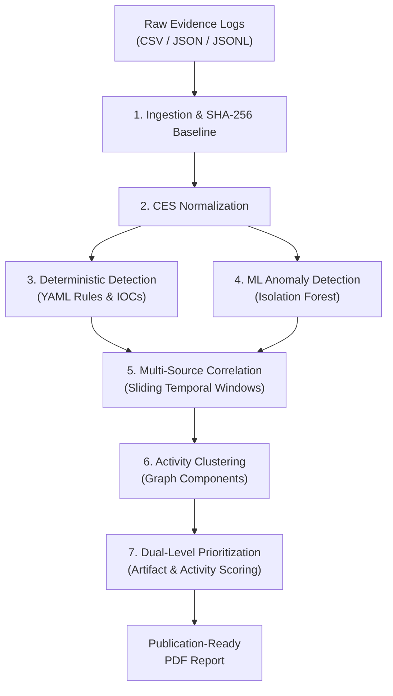

# ForensiQ System Architecture & Forensic Pipeline

ForensiQ is an offline, local-first digital forensics investigation workstation and evidence prioritization platform. It is engineered as a modular monolith providing automated, deterministic, and traceable analytical pipelines.

---

## 1. System Architecture & Boundaries

```
+------------------------------------------------------------------------+
|                          ForensiQ Workstation                          |
|                                                                        |
|  +------------------------------------------------------------------+  |
|  |             Frontend Interface (Vanilla ES6 SPA / CSS3)          |  |
|  |   - Investigation Operations Center   - Evidence Inspector       |  |
|  |   - Findings Quick-Filter Pills       - Correlations & Clusters  |  |
|  |   - Prioritization Breakdown Cards    - PDF Report Generator     |  |
|  +---------------------------------+--------------------------------+  |
|                                    | HTTP / REST (JSON)                |
|                                    v (127.0.0.1:8000)                  |
|  +------------------------------------------------------------------+  |
|  |                Backend Services (FastAPI / Python 3.11)          |  |
|  |   - Investigation Manager       - Evidence Ingestion & Verifier  |  |
|  |   - CES Normalization Engine    - Rule Heuristics & ML Isolation |  |
|  |   - Graph Correlation Engine    - Activity Clustering Engine     |  |
|  |   - Dual-Level Prioritization   - Flowable ReportLab Engine      |  |
|  +---------------------------------+--------------------------------+  |
|                                    | SQLAlchemy 2.0 ORM / Alembic      |
|                                    v                                   |
|  +------------------------------------------------------------------+  |
|  |                   Isolated Local Storage Engine                  |  |
|  |   - SQLite Database: %LOCALAPPDATA%\ForensiQ\database\forensiq.db|  |
|  |   - Immutable Raw Evidence: %LOCALAPPDATA%\ForensiQ\sources\     |  |
|  |   - Temporary Staging: %LOCALAPPDATA%\ForensiQ\staging\          |  |
|  +------------------------------------------------------------------+  |
+------------------------------------------------------------------------+
```

### Architectural Principles & Trust Boundaries

1. **Strict Loopback Binding**: All endpoints bind exclusively to `127.0.0.1`. Remote network access, open ports, or public exposures are strictly prohibited.
2. **Local-First & Air-Gapped**: 100% of telemetry, parsing, machine learning, and report generation executes locally. No data leaves the investigator workstation.
3. **External Data Directory Isolation**: Working databases and evidence storage reside outside the repository root in user-local directories (`%LOCALAPPDATA%\ForensiQ` on Windows), preventing accidental repository pollution or versioning of case data.
4. **Zero-Dependency Frontend**: The UI is built with standard ECMAScript 2022 and modern CSS3 (Dark Glassmorphism aesthetic). It requires zero Node.js build steps, bundling pipelines (Webpack/Vite), or external CDN scripts.
5. **Investigation State Isolation**: Pipeline executions and UI controls are scoped to individual case IDs. Execution ownership tokens (`pipelineExecutionCounter`) and case-keyed registries (`pipelineRunningByCase`) ensure that background pipeline completions cannot leak or corrupt state when switching investigations.

---

## 2. Core Forensic Pipeline (7 Stages)

ForensiQ executes a deterministic, 7-stage analytical pipeline that transitions raw unstructured logs into prioritized findings and executive reports.



### Stage 1: Ingestion & Cryptographic Verification
- **Ingestion**: Accepts CSV, JSON array, and newline-delimited JSON (JSONL) files up to 50 MB.
- **Cryptographic Baseline**: Immediately upon receipt, the backend streams the file, writes it to immutable disk storage, and computes its SHA-256 digest.
- **On-Demand Verification**: Investigators can re-verify bit-level file integrity at any time. The verifier recomputes the SHA-256 digest from disk to prove zero tampering or silent disk corruption.

### Stage 2: Canonical Event Schema (CES) Normalization
heterogeneous log records are parsed into a unified 9-dimension taxonomy:
- `timestamp`: UTC ISO-8601 normalized event timestamp.
- `event_type`: Categorical taxonomy (e.g., `PROCESS_START`, `AUTH_LOGIN`, `NETWORK_CONNECTION`, `FILE_MODIFY`).
- `user_id` & `user_domain`: Subject principal.
- `device_id` & `device_name`: Host workstation or asset.
- `process_name`, `process_path`, `process_command_line`, `parent_process_name`: Process lineage.
- `source_ip`, `destination_ip`, `destination_port`: Network endpoints.
- `file_path`, `file_hash_sha256`: File metadata.
- `status`: Execution outcome (`SUCCESS`, `FAILURE`).
- `raw_payload`: Full original unparsed JSON record preserved for forensic auditability.

### Stage 3: Deterministic Rule Detection
- Normalized records are evaluated against MITRE ATT&CK-aligned YAML rules in `data/rules/default_rules.yaml`.
- Supports exact matching, case-insensitive substring checks (`_contains`), list membership (`_in`), numeric thresholds (`_greater_than`), and IOC matching across IP addresses, domains, and hashes.
- Generates structured findings classified by severity: `CRITICAL`, `HIGH`, `MEDIUM`, `LOW`, `INFORMATIONAL`.

### Stage 4: Unsupervised ML Anomaly Detection
- Leverages Scikit-Learn's `IsolationForest` to identify behavioral and statistical outliers without requiring prior attack labels.
- Evaluates event frequency, port deviations, command-line entropy, and temporal clustering.
- Requires $\ge 10$ records to establish a valid baseline distribution. Produces anomaly findings with normalized scores ($0 - 100$).

### Stage 5: Multi-Dimensional Event Correlation
Discovers relational links across normalized events using a configurable sliding temporal window (default 30 minutes):
- **Temporal & Host**: Sequential events on the same asset.
- **Identity Traversal**: Events linked by identical user accounts across different workstations.
- **Network Flow**: Source and destination IP/port pairing.
- **Process Lineage**: Parent-child execution chains.
- Outputs weighted relationship graph edges connecting evidence records.

### Stage 6: Activity Clustering
- Performs connected-component graph analysis over correlation relationships and threat findings.
- Synthesizes disparate events into unified attack threads (e.g., *Initial Access $\rightarrow$ Privilege Escalation $\rightarrow$ Credential Access $\rightarrow$ Lateral Movement*).
- Identifies root entities (starting user, initial host, or initial process).

### Stage 7: Dual-Level Risk Prioritization
Applies explainable heuristic algorithms producing normalized scores ($0 - 100$):
1. **Baseline Artifact Prioritization**: Evaluates individual evidence records based on associated finding severity, detection confidence, and entity risk.
2. **Contextual Activity Prioritization**: Scores composite activity threads factoring in threat density, anomaly magnitude, timeline duration, and target asset criticality.

#### Score to Priority Tier Mapping
| Score Range | Priority Tier | Investigation Operational Meaning |
| :---: | :---: | :--- |
| **80 – 100** | `CRITICAL` | High-confidence active adversary compromise; requires immediate containment. |
| **60 – 79** | `HIGH` | Suspicious execution, credential access attempts, or confirmed IOC hits. |
| **40 – 59** | `MEDIUM` | Policy anomalies, anomalous administrative tools, or statistical outliers. |
| **20 – 39** | `LOW` | Minor behavioral deviations with low threat confidence. |
| **0 – 19** | `INFORMATIONAL` | Normal baseline operational events retained for chronological context. |

---

## 3. Database Architecture & Models

ForensiQ uses SQLite with SQLAlchemy 2.0 ORM and Alembic migrations.

### Key Entities
- **`Investigation`**: Top-level case container (`id`, `title`, `case_number`, `description`, `status`, `notes`).
- **`EvidenceSource`**: Stored evidence file (`id`, `investigation_id`, `original_filename`, `stored_filepath`, `sha256_hash`, `file_format`, `record_count`, `ingestion_status`).
- **`EvidenceRecord`**: Normalized CES record (`id`, `source_id`, `investigation_id`, `timestamp`, `event_type`, `user_id`, `device_id`, `process_name`, `source_ip`, `destination_ip`, `status`, `raw_payload`).
- **`Finding`**: Threat detection artifact (`id`, `investigation_id`, `rule_id`, `finding_type`, `severity`, `title`, `description`, `review_status`, `evidence_ids`).
- **`EvidenceRelationship`**: Discovered correlation link (`id`, `investigation_id`, `source_evidence_id`, `target_evidence_id`, `relationship_type`, `weight`, `context_attributes`).
- **`ActivityCluster`**: Aggregated attack thread (`id`, `investigation_id`, `activity_type`, `root_entity`, `start_time`, `end_time`, `evidence_ids`, `finding_ids`).
- **`PriorityResult`**: Risk scoring record (`id`, `investigation_id`, `target_type`, `target_id`, `priority_score`, `priority_tier`, `factor_breakdown`).

---

## 4. UI & Investigation Operations Center

The frontend provides an investigator workstation interface:
- **Operations Center**: Single primary "Analyze Investigation" trigger alongside individual stage rerun buttons.
- **Milestone Tracker**: Real-time progress through 5 investigative milestones (Ingest, Verify, Analyze, Triage, Export).
- **Findings Quick Filters**: Synchronized metric cards acting as interactive filter pills (e.g., Low includes both `LOW` and `INFORMATIONAL`).
- **Evidence Inspector**: Searchable, paginated CES table with slide-out raw payload viewer and interactive SHA-256 verification badges.
- **Correlations & Prioritization Panels**: Uncollapsed analysis views with bidirectional evidence navigation (`jumpToEvidenceRecord()`) and scoring factor breakdowns.
